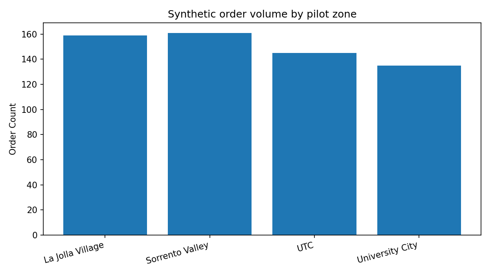
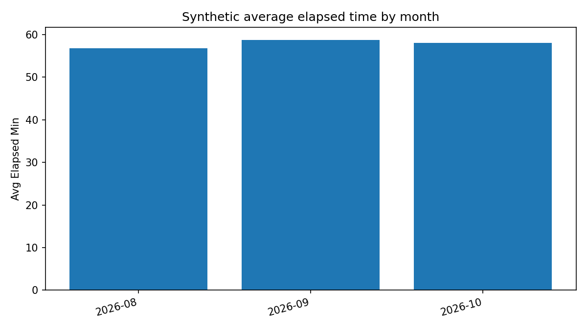
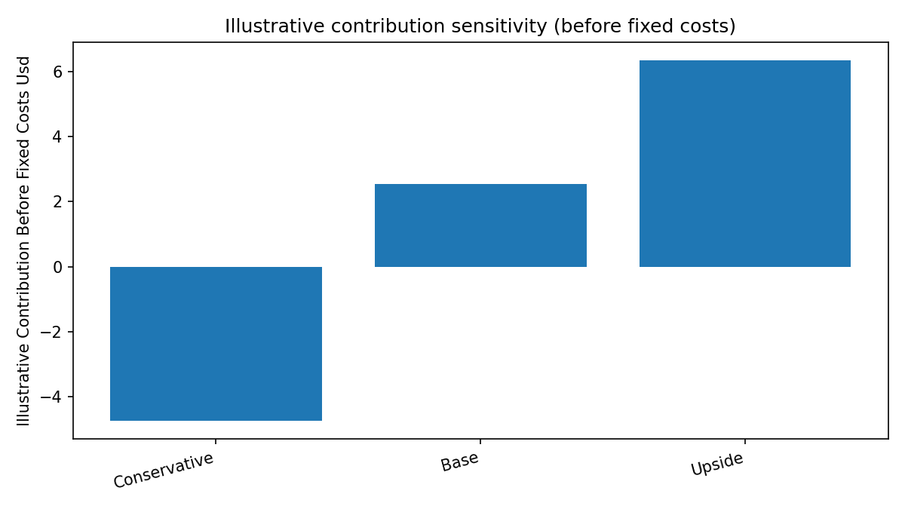
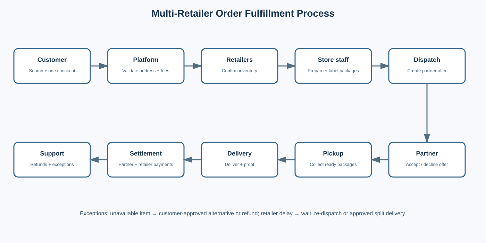
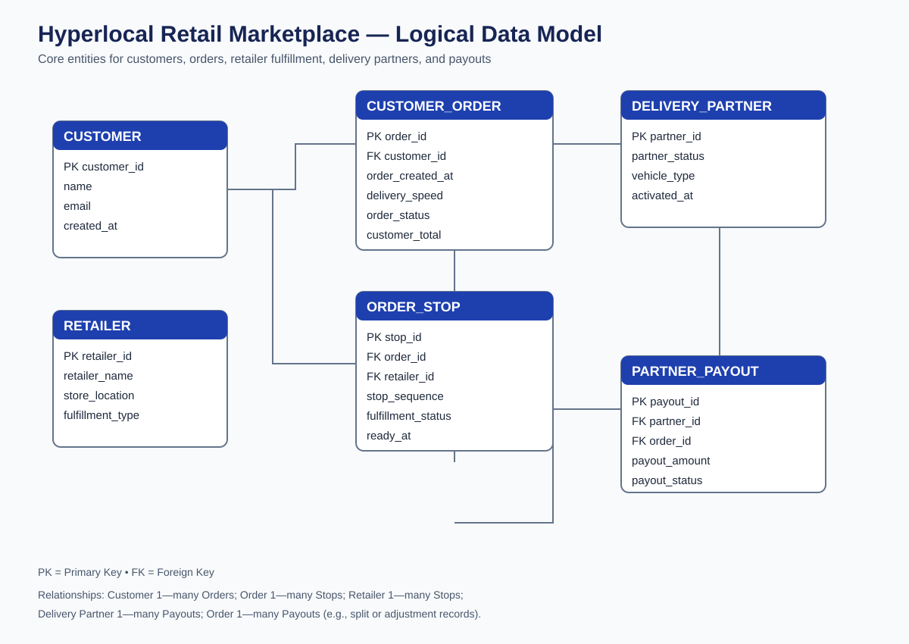

# Hyperlocal Retail Marketplace — Business Analysis Project

## Project Overview

This project explores the business feasibility and operational design of a hyperlocal, multi-category retail marketplace that connects customers with nearby physical retailers for convenient same-day delivery.

The proposed platform allows customers to discover and purchase products across categories such as fashion, beauty, electronics, home goods, gifts, and everyday essentials from participating local stores.

The project focuses on identifying business requirements, designing order fulfillment workflows, analyzing operational performance, and evaluating potential unit economics.

## Business Problem

Customers often face limited options when they need products quickly. Traditional e-commerce may not offer immediate delivery, while local retailers can have fragmented online shopping and fulfillment experiences.

This concept explores how a unified marketplace could make local retail inventory more accessible while creating an additional sales channel for participating merchants.

## Project Objectives

- Define business requirements and operational workflows.
- Design a multi-store order and delivery process.
- Develop a relational database structure.
- Analyze synthetic order and fulfillment data using SQL.
- Evaluate pricing assumptions and contribution economics.
- Prepare datasets and specifications for Tableau dashboards.

## Tools & Technologies

- SQL — database design and business analysis queries
- Excel — data analysis and financial modeling
- Tableau — dashboard planning and visualization
- Data modeling — entity relationship design
- Business analysis — requirements, user stories, and process mapping

## Project Deliverables

- Business Requirements Document
- User Stories and Acceptance Criteria
- Data Dictionary
- SQL Database Schema and Analysis Queries
- Synthetic Order and Retailer Datasets
- Excel Analysis Workbook
- Unit Economics Scenarios
- Order Fulfillment Process Diagram
- Entity Relationship Diagram
- Tableau-Ready Datasets and Dashboard Guide

## Analytical Focus

The analysis explores:

- Order volume and delivery performance
- Fulfillment time and operational efficiency
- Multi-retailer order complexity
- Delivery pricing and partner compensation
- Contribution margin under different business scenarios
- Potential opportunities for improving the customer experience

## Data Disclaimer

All transaction and operational datasets are synthetic and created for this portfolio project. Retailer examples are research prospects, not confirmed business partners. Pricing, costs, and financial projections are illustrative assumptions rather than validated business results.

## Project Status

Business analysis and initial modeling completed. Further validation, dashboard implementation, and operational testing would be required before a real-world launch.
## Visual Analysis

### Order Distribution by Zone

### Delivery Performance Over Time

### Contribution Economics Scenarios

## Business Process Flow

## Database Design

